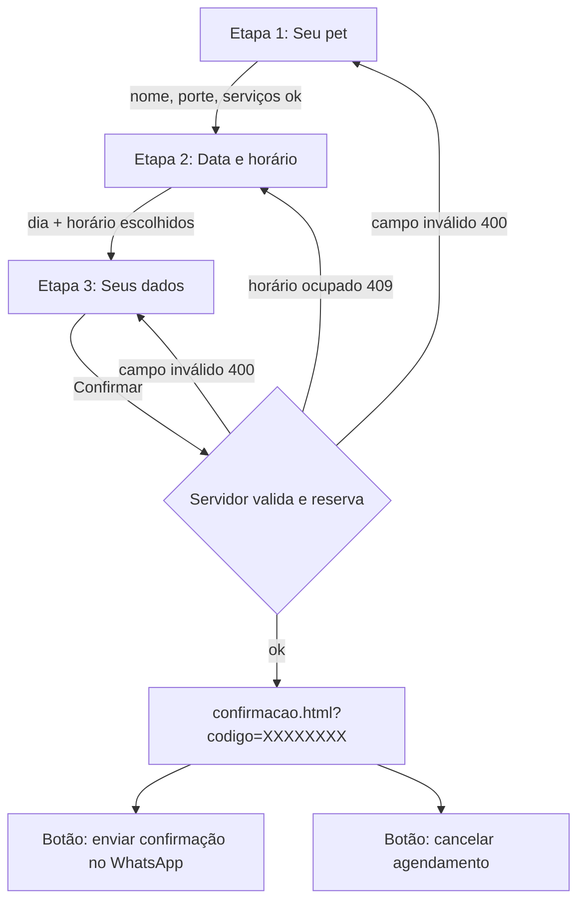

# 2. Layout e fluxo do formulário de agendamento

Formulário em **3 etapas** na página `agendar.html`, com barra de progresso.
Na tela grande há uma coluna lateral com "Como funciona" e o horário do
salão; no celular o formulário ocupa a largura toda.



## Etapa 1 — Seu pet
```
[ Nome do pet *      ]  [ Raça (opcional) ]
Espécie:  (•) Cão  ( ) Gato
Porte *:  [Pequeno até 10kg] [Médio 10–25kg] [Grande >25kg]
Serviços * (vários):  [ ] Banho   [ ] Tosa higiênica  ...
                                         [ Escolher data e horário → ]
```

## Etapa 2 — Data e horário
```
Tempo estimado de atendimento: 1h30
 ‹   novembro de 2026   ›
 Dom Seg Ter Qua Qui Sex Sáb      (dias sem vaga/fechados ficam riscados)
 ...
Horários em quarta-feira, 11/11/2026
 (08:00) (08:30) (09:00) ...
 [ ← Voltar ]                         [ Continuar → ]
```
O calendário e os horários vêm da API — mostram só o que realmente está
livre para a duração calculada (serviços + porte).

## Etapa 3 — Seus dados
```
Resumo: Pet | Serviços | Quando (dia, das 09:00 às 10:30)
[ Seu nome *  ]   [ WhatsApp/telefone * (máscara) ]
[ E-mail (opcional) ]   [ Observações (opcional) ]
 [ ← Voltar ]                  [ Confirmar agendamento ]
```

## Tela de confirmação (`confirmacao.html`)
Código grande (ex.: `YM2P8D6S`), resumo, endereço, botão **"Enviar
confirmação no WhatsApp"** (abre `wa.me` com mensagem pronta contendo pet,
serviço, dia, hora e código) e botão **"Cancelar agendamento"**.

## Decisões de usabilidade
- Erros aparecem junto do campo e o formulário volta para a etapa certa.
- Se outra pessoa pegar o horário antes, o cliente volta à etapa 2 com
  a lista atualizada e uma mensagem clara.
- Campos com rótulo, foco visível, `aria-live` e navegação por teclado.
- O horário **não** é confirmado "de fato" no WhatsApp: ele já está
  reservado no sistema; o WhatsApp é só um aviso para a Selma.
