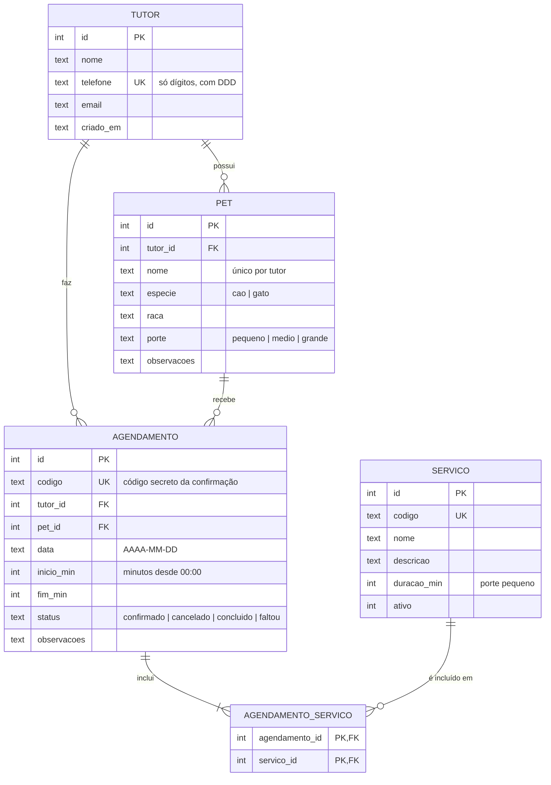

# 3. Modelagem da base de dados

Banco: **SQLite** (arquivo único, sem instalar servidor — adequado para o
porte do projeto). Esquema completo e comentado em `server/schema.sql`.

## Escolhas de modelagem
- **Horário em minutos** (`inicio_min`/`fim_min`): checar sobreposição vira
  uma comparação de números, sem lidar com fuso/formatos de hora.
- **N:N agendamento ↔ serviço**: um atendimento pode ter vários serviços.
- **Tutor identificado pelo telefone** (único). Um cadastro já existente
  não é alterado por quem apenas conhece o número.
- **Restrições no próprio banco** (`CHECK`, `UNIQUE`, chaves estrangeiras):
  mesmo que a aplicação falhe, dados inválidos não entram.
- **Código do agendamento** com 8 caracteres de um alfabeto sem letras
  confusas (sem 0/O/1/I): ~10¹² combinações, serve como "senha" do
  cliente para consultar/cancelar sem criar conta.
- Índices em `(data, status)` e `(pet_id, data)` para as consultas da agenda.
